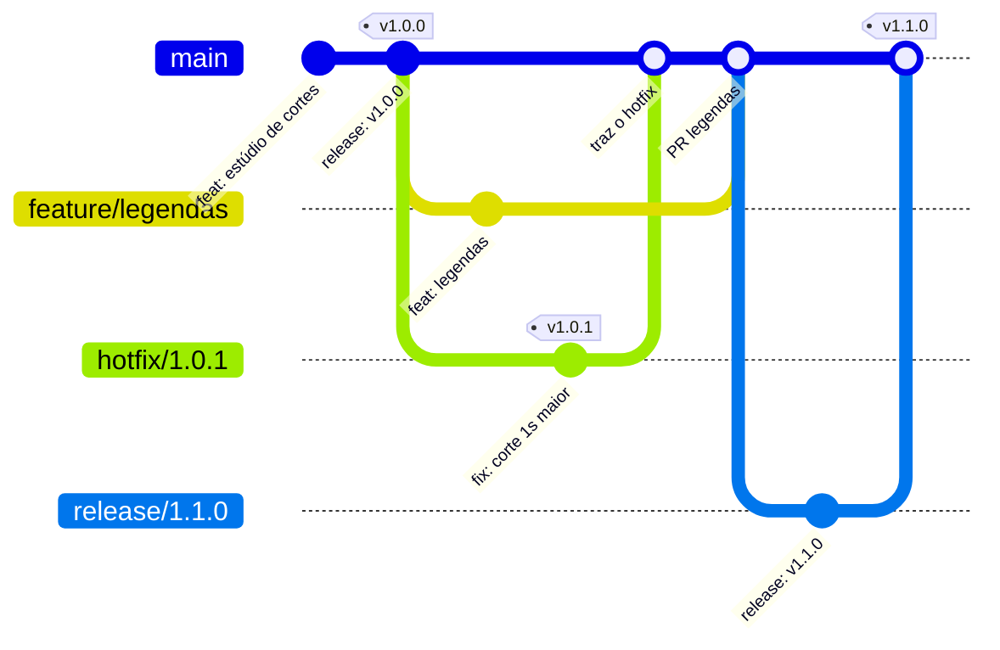
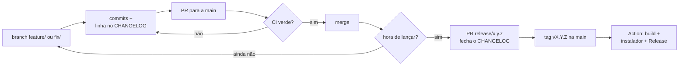

# Versionamento e releases

Como uma mudança sai da ideia e chega no instalador publicado no GitHub.

## As regras em uma tela

| Regra | Por quê |
|---|---|
| A `main` está sempre pronta para lançar e só recebe código por **PR com CI verde**. | Qualquer commit da `main` pode virar release sem susto. |
| A versão é a **tag do git** `vX.Y.Z` ([SemVer](https://semver.org/lang/pt-BR/)). Nenhum arquivo guarda o número. | Uma única fonte de verdade: o workflow passa a versão da tag para o exe, o instalador e o título do app. |
| Todo PR com mudança visível acrescenta uma linha em **`## [Não lançado]`** no [CHANGELOG.md](../CHANGELOG.md). | O changelog se escreve sozinho, no momento em que o contexto está fresco. |
| **Enviar a tag dispara a release.** | O [workflow de release](../.github/workflows/release.yml) compila, gera o instalador e publica a Release com as notas do changelog. |

## Qual número muda (SemVer neste app)

| Parte | Quando | Exemplos no YtCortador |
|---|---|---|
| **MAJOR** `2.0.0` | Muda o jeito de usar ou quebra algo que já funcionava. | Nova estrutura de pastas de saída; passa a exigir outro programa instalado. |
| **MINOR** `1.1.0` | Funcionalidade nova, compatível. | Legenda nos cortes; outro modelo de miniatura. |
| **PATCH** `1.0.1` | Correção, sem mudar o comportamento esperado. | Corte com 1 s a mais; miniatura com texto cortado. |
| **Pré-release** `1.1.0-rc.1` | Versão para testar antes da final. | Testar o instalador novo antes de liberar. Sai marcada como *pre-release*. |

## Branches

| Branch | Sai de | Volta para | Uso |
|---|---|---|---|
| `main` | — | — | Estável. Protegida. |
| `feature/<descrição>` | `main` | `main` (PR) | Funcionalidade nova. Ex.: `feature/legendas` |
| `fix/<descrição>` | `main` | `main` (PR) | Correção que pode esperar a próxima release. |
| `release/<x.y.z>` | `main` | `main` (PR) | Só fecha o changelog da versão. Vive minutos. |
| `hotfix/<x.y.z>` | **a tag** em produção | tag + `main` (PR) | Correção urgente quando a `main` já tem coisa não lançada. |

## Mensagens de commit ([Conventional Commits](https://www.conventionalcommits.org/pt-br/))

`tipo: descrição no imperativo`. O tipo diz que número a mudança pede:

| Tipo | Significa | Versão |
|---|---|---|
| `feat:` | funcionalidade nova | MINOR |
| `fix:` | correção de bug | PATCH |
| `feat!:` ou rodapé `BREAKING CHANGE:` | quebra compatibilidade | MAJOR |
| `docs:` `refactor:` `perf:` `ci:` `build:` `chore:` | não muda o comportamento | nenhuma |

Exemplos: `feat: marca o fim do corte com a tecla F`, `fix: miniatura cortava títulos com 5 linhas`.

## O fluxo inteiro em um desenho

Release 1.0.0 → começa uma feature → aparece um bug urgente em produção → hotfix 1.0.1 sai **sem** levar a feature pela metade → a feature entra → release 1.1.0.





---

## Passo a passo

### 1. Nova feature (ou correção comum)

```powershell
git switch main
git pull
git switch -c feature/legendas
```

Desenvolva e faça commits no padrão. Antes do PR, registre a mudança no `CHANGELOG.md`, dentro de `## [Não lançado]`, na categoria certa (**Adicionado**, **Alterado**, **Corrigido**, **Removido**, **Obsoleto**, **Segurança**):

```markdown
## [Não lançado]

### Adicionado
- Legendas automáticas nos cortes.
```

```powershell
git push -u origin feature/legendas
gh pr create --fill --base main
```

O CI compila o PR. Com ele verde, faça o merge (prefira **squash**: um commit `feat: ...` por PR deixa o histórico legível).

Correções que podem esperar a próxima versão seguem igual, com `fix/<descrição>` e a categoria **Corrigido**.

### 2. Release

**a) Decida o número** olhando o `[Não lançado]`: tem quebra → MAJOR; tem algo em *Adicionado* → MINOR; só *Corrigido* → PATCH.

**b) Feche o changelog num PR de release:**

```powershell
git switch main
git pull
git switch -c release/1.1.0
```

No `CHANGELOG.md`, renomeie o conteúdo de `[Não lançado]` para a versão com a data e deixe um `[Não lançado]` vazio em cima. Atualize os links do rodapé:

```markdown
## [Não lançado]

## [1.1.0] - 2026-12-02

### Adicionado
- Legendas automáticas nos cortes.

[Não lançado]: https://github.com/frankllin15/yt-dowloader-cut/compare/v1.1.0...HEAD
[1.1.0]: https://github.com/frankllin15/yt-dowloader-cut/compare/v1.0.1...v1.1.0
```

```powershell
git commit -am "release: v1.1.0"
git push -u origin release/1.1.0
gh pr create --fill --base main
```

**c) (Opcional) Release candidate.** Para testar o instalador antes, envie uma tag de pré-release a partir da branch de release:

```powershell
git tag -a v1.1.0-rc.1 -m "v1.1.0-rc.1"
git push origin v1.1.0-rc.1
```

Ela sai como *pre-release*, com as notas da seção `[1.1.0]`, e não vira a "Latest". Achou problema? Corrija na branch e envie `v1.1.0-rc.2`.

**d) Merge do PR, tag na `main` e push da tag:**

```powershell
git switch main
git pull
git tag -a v1.1.0 -m "v1.1.0"
git push origin v1.1.0
```

**e) Acompanhe:**

```powershell
gh run watch
gh release view v1.1.0 --web
```

A Release traz o `YtCortador-Setup.exe` (instalador) e o `YtCortador.exe` (portátil). O link
`https://github.com/frankllin15/yt-dowloader-cut/releases/latest/download/YtCortador-Setup.exe`
sempre aponta para o instalador mais recente.

### 3. Hotfix

**Caso simples:** a `main` não tem nada não lançado. Faça um `fix/...` normal e uma release PATCH (passo 2).

**Caso real:** a `main` já tem features que ainda não podem sair. Corrija a partir **da tag que está em produção**:

```powershell
git fetch --tags
git switch -c hotfix/1.0.1 v1.0.0
```

Corrija, e no `CHANGELOG.md` dessa branch crie direto a seção da versão:

```markdown
## [1.0.1] - 2026-11-28

### Corrigido
- Corte saía com 1 segundo a mais no fim.
```

Lance a partir da própria branch de hotfix:

```powershell
git commit -am "fix: corte saía com 1 segundo a mais"
git push -u origin hotfix/1.0.1
git tag -a v1.0.1 -m "v1.0.1"
git push origin v1.0.1
```

Depois **traga o hotfix para a `main`** (senão o bug volta na 1.1.0):

```powershell
gh pr create --base main --head hotfix/1.0.1 --title "fix: traz o hotfix 1.0.1 para a main"
```

O conflito esperado é no `CHANGELOG.md`: mantenha o `[Não lançado]` da `main` em cima e a seção `[1.0.1]` logo abaixo.

### 4. Quando algo dá errado

| Situação | O que fazer |
|---|---|
| A Action falhou **antes** de publicar (sem seção no changelog, erro de build). | Corrija, apague a tag e envie de novo: `git tag -d v1.1.0`, `git push --delete origin v1.1.0`, depois recrie. |
| A Release saiu, mas com bug. | **Não reaproveite a tag.** Quem baixou tem a `v1.1.0` com bug. Lance a `v1.1.1` (hotfix) e, se quiser, edite as notas da `v1.1.0` avisando. |
| Tag no commit errado e a Release já saiu. | Apague a Release e a tag no GitHub e no local, e recrie. Só faça isso se ninguém baixou ainda. |

---

## Configuração única no GitHub

Proteja a `main` para que o fluxo valha de verdade: PR obrigatório e CI verde (o check se chama `build`):

```powershell
gh api -X PUT repos/frankllin15/yt-dowloader-cut/branches/main/protection `
  -F "required_status_checks[strict]=true" -F "required_status_checks[contexts][]=build" `
  -F "enforce_admins=false" -F "required_pull_request_reviews[required_approving_review_count]=0" `
  -F "restrictions=null"
```

E nos *Settings* do repositório, em **Pull Requests**, deixe só **Allow squash merging** marcado.
